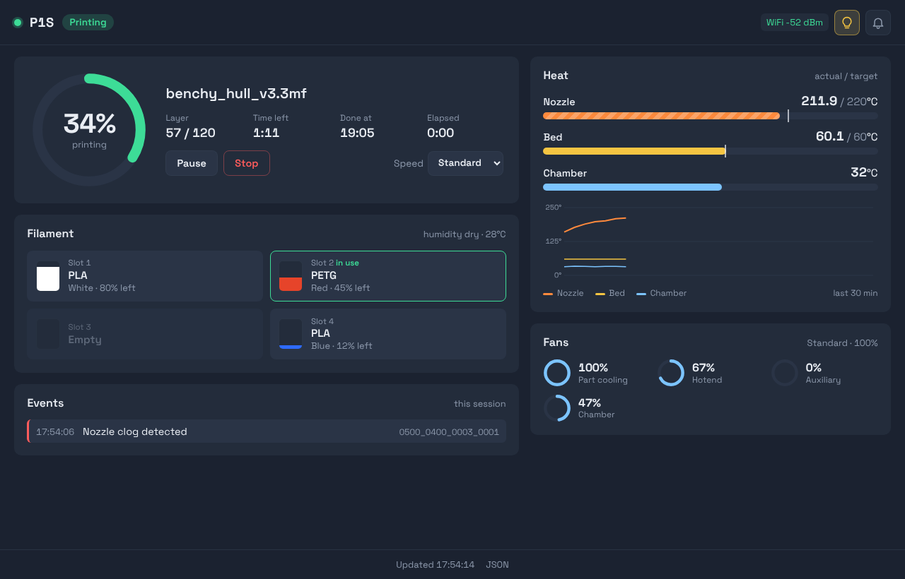

# Bambu Lab P1S Monitor

A Bambu Lab P1S printer monitor that connects over MQTT and streams live status. Available as a **terminal TUI** or a **web dashboard** (via Docker).

## Features

- **Two-column responsive layout** — print info on the left, temps/fans on the right; falls back to single column in narrow terminals (<60 cols)
- Real-time print progress with adaptive progress bar, layer info, and ETA
- Nozzle, bed, and chamber temperature display
- Fan speed monitoring (part cooling, hotend, auxiliary, chamber)
- **AMS filament display** — slot-by-slot filament type and color name, plus humidity and temperature per unit
- **WiFi signal strength** in the header
- HMS error/warning codes with human-readable descriptions (word-wrapped to fit columns)
- Toggle chamber light via keyboard
- Color-coded terminal output
- Graceful Ctrl+C disconnect

## Requirements:

- Python 3.8+
- Bambu Lab P1S printer in LAN-only dev mode
- Printer's IP address, serial number, and LAN access code

## Setup

```bash
pip install -r requirements.txt
cp .env.example .env
```

Edit `.env` with your printer's details:

```
BAMBU_IP=192.168.1.100
BAMBU_SERIAL=your_serial_number
BAMBU_ACCESS_CODE=your_lan_access_code
```

You can find the LAN access code in the printer's settings under **Network > LAN Only Mode**.

## Usage

```bash
python bambu_monitor.py
```

The monitor connects to the printer's MQTT broker over TLS (port 8883), requests a full status dump, then continuously displays updates as they arrive.

### Keyboard Commands

While the monitor is running:

| Key | Action |
|-----|--------|
| `l` | Toggle chamber light |

Any other key clears on-screen messages.

### Layout

At 80+ columns, the monitor renders a two-column layout:

```
==============================================================================
 Bambu P1S Monitor                                           WiFi: -39dBm
==============================================================================

  State:  Printing                         Temperatures
  File:   benchy.3mf                         Nozzle:  215.0/220°C
  Progress: [████████████░░░░░░] 67%         Bed:     60.0/60°C
  Layer:   45/120                            Chamber: 32°C
  ETA:     1:23                            Fans
                                             Part cooling: 100%
                                             Hotend:       67%

  ⚠ Errors (this session)                 AMS Filaments
    [14:23:01] Nozzle clog detected          H:4% T:28°C
                                             Slot 1: PLA (White)
                                             Slot 2: PLA (Black)
                                             Slot 3: (empty)
                                             Slot 4: PLA (Red)

  Last update: 14:23:05
  l:toggle light
  Ctrl+C to exit
```

Terminals narrower than 60 columns automatically fall back to a single-column view.

### Debug Mode

To log raw MQTT JSON to a file:

```bash
BAMBU_DEBUG=/tmp/bambu.log python bambu_monitor.py
```

## Web Dashboard (Docker)

A browser-based dashboard built to be read from across the room: a large progress ring, heat bars that show actual vs target, spool tiles for each AMS slot, a 30-minute temperature chart, and a small set of printer controls.



### Requirements

- [Docker Desktop](https://www.docker.com/products/docker-desktop/) installed and running
- Printer accessible on your local network

### Quick Start

```bash
# Set your printer credentials (or use your existing .env file)
export BAMBU_IP=192.168.1.100
export BAMBU_SERIAL=your_serial_number
export BAMBU_ACCESS_CODE=your_lan_access_code

docker compose up --build
```

Open `http://localhost:8080` in your browser.

### Features

- Live updates over Socket.IO; reconnects on its own and warns when the printer has gone quiet
- Progress ring with layer count, time left, wall-clock finish time, and elapsed time
- Current print stage (bed leveling, heating, filament change, and so on) shown under the file name
- Heat bars for nozzle, bed, and chamber with the target marked and an animated stripe while heating
- Temperature history chart for the last 30 minutes (kept on the server, so a fresh tab gets the history too)
- AMS slot tiles with color swatch, filament type, color name, remaining percentage, and the slot currently in use; external spool shown when loaded
- Fan dials for part cooling, hotend, auxiliary, and chamber
- Printer controls: pause, resume, stop (with confirmation), speed profile (Silent/Standard/Sport/Ludicrous), and chamber light
- Browser notifications when a print finishes, fails, or pauses (click the bell to enable)
- Tab title shows the progress percentage while printing
- Event log with a link to the Bambu wiki entry for each HMS code
- Works on a phone, a tablet by the printer, or a desktop

### Controls

Controls are on by default. To run the dashboard display-only, set `BAMBU_CONTROLS=0` in your environment or `.env`.

### JSON API

The dashboard also exposes its state for other tools (Home Assistant, scripts, a status screen):

| Endpoint | Description |
|----------|-------------|
| `GET /api/state` | Current printer snapshot as JSON |
| `GET /api/history` | Temperature samples for the last 30 minutes |
| `POST /api/command` | Send a command: `{"action": "pause"}`, `resume`, `stop`, `{"action": "speed", "value": 2}`, `{"action": "light", "value": true}` |

## How It Works

The printer exposes an MQTT broker with TLS on port 8883. The monitor authenticates with username `bblp` and the LAN access code, subscribes to `device/{SERIAL}/report`, and sends a `pushall` command to get the initial state. Subsequent updates are pushed by the printer automatically during prints.
